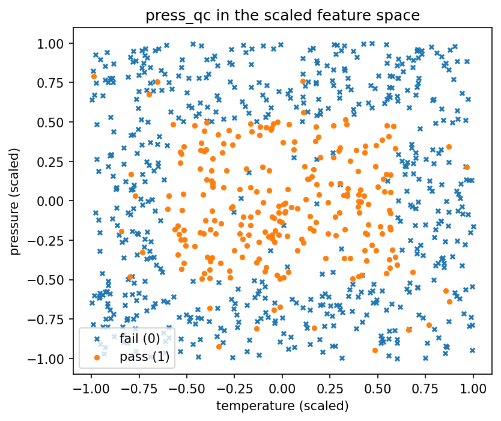
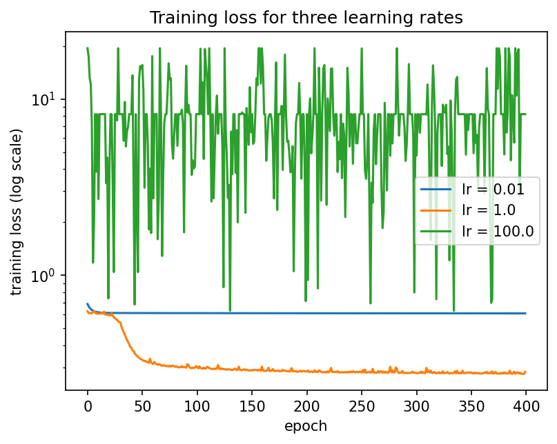
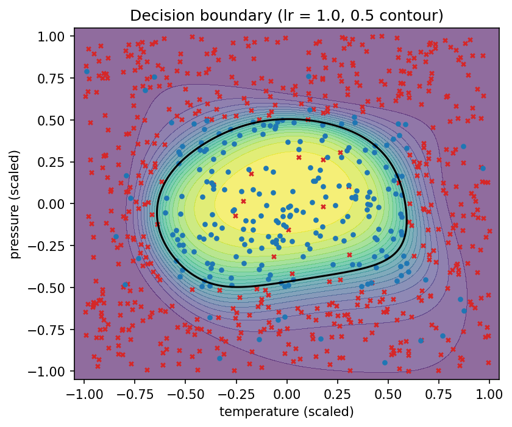

# Lab 4-1 리포트 — 20212788 최재원

## 1. 수행 내용

스켈레톤의 네 TODO 블록을 명세대로 구현했고, 벗어난 부분은 없습니다. `sigmoid`는 `z`의
부호로 나누어 `z >= 0`에서는 `1/(1+exp(-z))`를, `z < 0`에서는 `exp(z)/(1+exp(z))`를 쓰므로
지수의 인자가 항상 0 이하가 되어 오버플로가 발생하지 않습니다.

`gradient_check`는 해석적 기울기를 다시 유도하지 않고 `backward()`를 그대로 호출해 비교했고,
`params[key].ravel()`이 돌려주는 뷰에 직접 써서 섭동을 넣은 뒤 원값으로 되돌렸습니다.

## 2. 결과

**표 1. 기울기 검증.** 해석적 기울기와 중앙차분 수치미분의 최대 상대오차가 통과 기준보다 한
자릿수 이상 작으므로, 이후 학습 곡선에서 무엇이 보이든 그것은 역전파 식의 오류가 아니라 학습률
때문이라고 말할 수 있습니다.

| 항목 | 값 |
|------|-----|
| 해석적 기울기 vs 수치미분 최대 상대오차 | **9e-08** |
| 통과 기준 | 1e-6 |

파라미터별로는 `W1` 9e-08, `b1` 1.11e-09, `W2` 2.64e-11, `b2` 1.35e-11로, 역전파 연쇄가
가장 길어 기울기가 가장 작은 `W1`에서 오차가 가장 큽니다.

**표 2. 학습률 세 개, 같은 분할·같은 시드·같은 초기 가중치.** 세 실행을 가장 뚜렷하게
가르는 열은 `Max train loss`입니다. lr = 100은 마지막 손실만 보면 8.2로 평범해 보이지만
학습 내내 진동했고, 그 사실은 최댓값에만 남습니다.

| 학습률 | Final train loss | Max train loss | Final val loss | Final val accuracy | Best val accuracy |
|---------------|------|------|------|------|------|
| 0.01 | 0.6065 | 0.6853 | 0.6049 | 0.7063 | 0.7063 |
| **1.0** | **0.2822** | 0.6247 | **0.3608** | **0.8812** | **0.8938** |
| 100.0 | 8.2030 | **19.4281** | 8.1166 | 0.7063 | 0.7063 |
| 다수 클래스 baseline (검증 분할) | n/a | n/a | n/a | 0.7063 | n/a |

검증 분할 160개 중 양성 비율은 0.2938이므로 전부 "불합격"으로 찍으면 정확도가 0.7063이
됩니다. lr = 0.01과 lr = 100의 최종 정확도가 **이 값과 소수점까지 같다**는 점이 중요합니다.

## 3. 그림

**그림 1. 두 압착 설정과 합격 여부.** 합격한 부품은 온도와 압력이 **둘 다** 중앙 부근인
영역에만 모여 있고, 그 바깥은 사방이 전부 불합격입니다. 합격 영역이 평면 한가운데 놓인 닫힌
사각형 모양이라는 점이 이 과제의 출발점입니다.

**그림 2. 학습률 세 개의 학습 손실 (y축 로그 스케일).** 세 곡선은 최종값보다 모양이 다릅니다.
lr = 0.01은 거의 수평선이고, lr = 1.0은 50 에폭 부근까지 떨어진 뒤 완만해지며, lr = 100은
0.7에서 19.4 사이를 400 에폭 내내 불규칙하게 오갑니다.

**그림 3. 학습된 네트워크의 결정 경계 (lr = 1.0, 확률 0.5 등고선).** 경계가 모서리만 둥근
닫힌 사각형을 이루어 그림 1의 합격 영역을 거의 그대로 감쌉니다. 다만 모서리가 실제보다 둥글게
깎여 있어 네 귀퉁이 근처의 점들이 잘못 분류됩니다.

## 4. 해석

**사각형 합격 영역에는 은닉층이 반드시 필요합니다.** 그림 1에서 합격 부품은 평면 가운데
닫힌 영역에 모여 있고 그 바깥은 대부분 불합격입니다. 은닉층이 없는 로지스틱 회귀는 입력의
가중합에 시그모이드를 씌운 것이므로 결정 경계가 직선 하나뿐이고, 직선은 평면을 두 쪽으로만
가르는데, 가운데만 합격인 영역은 어떤 직선으로도 만들 수 없습니다. 은닉 유닛들은 각각
자기 방향으로 시그모이드 경계를 하나씩 만들고, 출력층이 그것들을 가중합하여 닫힌 영역을 만듭니다. 그림 3의 경계가 모서리만 둥근 사각형인 것이 바로 그
구조입니다.

**그림 2의 세 곡선은 보폭의 세 가지 상태입니다.** lr = 0.01은 보폭이 너무 작아 400 epoch
동안 손실이 0.6853에서 0.6065로 0.0788만 줄었습니다. 방향은 맞지만 너무 오래 도달하지
못한 경우이고, 표 2에서 정확도가 baseline과 같은 0.7063에 머문 것을 확인할 수 있었습니다.
lr = 1.0은 50 epoch 부근까지 가파르게 내려간 뒤 완만해지는, 정상적으로 수렴한 모양입니다.
lr = 100은 보폭이 골짜기 폭보다 커서 매 갱신마다 최솟값을 넘어 반대편으로 튀고, 그래서 진동이 남은 것으로 보입니다.

**lr = 100의 최종 손실이 평범해 보이는 것은 착시입니다.** 표 2에서 그 실행의 최종 학습
손실은 8.2030인데, 이는 400번째 epoch이라는 한 시점을 찍은 값일 뿐입니다. 마지막 50 에폭만
보아도 손실이 0.695에서 19.428 사이를 오가므로, 측정 시점이 조금만 달랐어도 전혀 다른 숫자가
나왔을 것이라 생각됩니다. 진동하는 실행에서 마지막 값은 정보가 아니며, 그래서 명세가
`max_train_loss`를 함께 기록하도록 한 것 같습니다. 정확도가 baseline과 똑같이 0.7063이라는
사실도 같은 이야기를 합니다. 손실 8.2는 "조금 못 맞힌다"가 아니라 **전부 한 클래스로 찍고
있다**는 뜻입니다.

**기울기 검증을 먼저 돌려야 하는 이유는 원인을 분리하기 위해서입니다.** 역전파 식이 틀려도
프로그램은 멈추지 않고 어떤 값이든 출력합니다. 학습이 안 될 때 그것이 잘못된 기울기
때문인지 잘못된 학습률 때문인지 구분할 방법이 없으면 둘을 동시에 의심하게 됩니다. 표 1의
9e-08은 기울기 쪽 가능성을 먼저 지워 주며, 그 덕분에 그림 2의 세 곡선 차이를 온전히 학습률의
효과로 읽을 수 있게 되었습니다.

## 5. 한계

모든 수치가 하나의 분할, 하나의 시드, 하나의 초기 가중치에서 나왔습니다. `init_params`가
모두에게 같은 출발점을 주므로 그대로 재현되겠지만, 다른 초기값에서도 lr = 1.0이 최선이라는
보장은 없다고 생각됩니다. 또한 시험한 학습률이 0.01, 1.0, 100.0 세 개뿐이고 간격이 100배씩이어서,
1.0과 100.0 사이 중 어딘 근처가 가장 나을 지는 이 실험으로 확인되지 않습니다. 표 2에서 lr = 1.0의
학습 손실 0.2822와 검증 손실 0.3608의 차이 0.0786은 과적합이 시작되고 있음을 보여주므로,
epoch 수까지 함께 조정하면 결론이 달라질 수 있다고 생각됩니다.

## AI 및 외부 코드 사용

| 도구 / 출처 | 사용한 부분 | 내가 수정하고 검증한 내용 |
|-------------|-------------|---------------------------|
| Claude (Anthropic) | `src/lab04_1.py`의 네 TODO 블록 코드 초안 작성, numpy API 확인, `lab04_1_concepts.pdf` 내용 설명 | 초안을 읽고 각 줄의 의미를 확인한 뒤 내 코딩 스타일에 맞게 정리했다. 공개 테스트 6개와 `gradient_check`의 9e-08로 동작을 검증했다. |
| Claude (Anthropic) | 리포트 초안 작성(섹션 구성, 표 1·2 수치 정리, 파라미터별 기울기 오차·에폭별 손실 범위 계산) | 초안을 읽고 이해한 뒤 내 문장으로 다시 썼다. 인용된 수치는 `results.json` 및 `src/lab04_1.py`의 출력과 직접 대조해 확인했다. |
