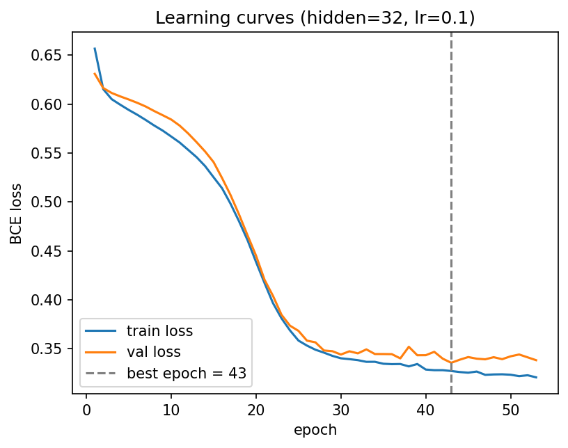
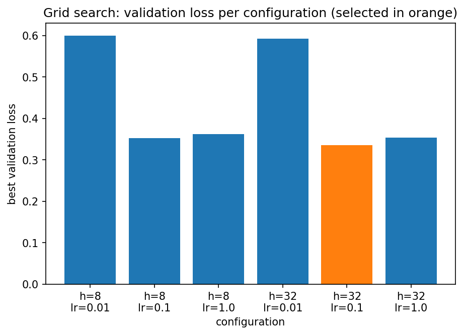
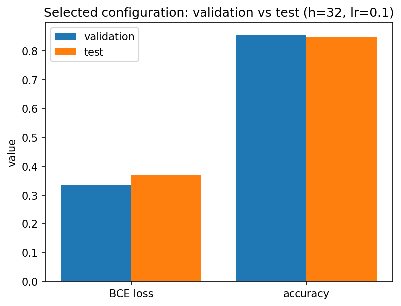

# Lab 4-2 리포트 — 20212788 최재원

## 1. 수행 내용

스켈레톤의 네 TODO 블록을 명세대로 구현했고, 벗어난 부분은 없습니다. `train_model`은 검증
손실이 갱신될 때마다 `copy.deepcopy(model.state_dict())`로 가중치를 저장해 두었다가 루프가
끝난 뒤에 복원하므로, 함수가 반환될 때 모델은 마지막 에폭이 아니라 최적 에폭의 가중치를
들고 있습니다.

`run_experiment`는 설정마다 `set_seed()`를 먼저 호출해 같은 은닉 크기에서 시도하는 세
학습률이 동일한 초기 가중치와 동일한 배치 순서로 출발하도록 했고, 여섯 설정의 모델을 모두
보관했다가 검증 손실이 가장 낮은 하나로만 테스트 로더를 **한 번** 평가했습니다.

## 2. 결과

**표 1. 여섯 설정을 검증으로 채점하고, 그중 하나만 테스트로 채점.** 선택은 검증 **손실**이
가장 낮은 행(은닉 32, 학습률 0.1)으로 했으며, 검증 정확도가 가장 높은 행은 따로 있습니다.

| 은닉 크기 | 학습률 | 최적 에폭 | 실행 에폭 | 검증 손실 | 검증 정확도 |
|------|------|------|------|------|------|
| 8 | 0.01 | 80 | 80 | 0.600035 | 0.7000 |
| 8 | 0.1 | 52 | 62 | 0.352824 | 0.8675 |
| 8 | 1.0 | 15 | 25 | 0.362131 | 0.8500 |
| 32 | 0.01 | 80 | 80 | 0.592339 | 0.7000 |
| **32** | **0.1** | **43** | **53** | **0.335632** | 0.8550 |
| 32 | 1.0 | 20 | 30 | 0.354082 | **0.8700** |

선택된 설정: 은닉 크기 **32**, 학습률 **0.1**.
테스트 손실 **0.370398**, 테스트 정확도 **0.8475** (위 표가 완성된 뒤 한 번만 측정).

검증 분할 400개의 다수 클래스 비율은 0.7000, 테스트 분할은 0.7025입니다.

## 3. 그림

**그림 1. 선택된 설정의 학습·검증 손실.** 두 곡선은 25 에폭 부근까지 거의 겹쳐서 내려오다가
그 뒤로 벌어지기 시작해, 학습 손실은 계속 떨어지는 반면 검증 손실은 평평해지고 미세하게
올라갑니다. 조기 종료는 검증 손실이 최소였던 43 에폭의 가중치를 남기고 53 에폭에서
멈췄습니다.

**그림 2. 여섯 설정의 검증 손실.** 학습률이 압도적으로 큰 요인입니다. 학습률을 0.01에서
0.1로 바꾸면 손실이 약 0.25 떨어지는 반면, 같은 학습률에서 은닉 크기를 8에서 32로 키워
얻는 차이는 0.02 안팎에 그칩니다.

**그림 3. 선택된 설정의 검증과 테스트 비교.** 같은 가중치인데도 테스트 쪽이 손실은 0.0348
높고 정확도는 0.0075 낮습니다. 방향은 예상대로 테스트가 나쁜 쪽이지만, 그 폭은 결론을
뒤집을 만큼 크지 않습니다.

## 4. 해석

**학습률이 너무 작으면 모델은 다수 클래스만 답합니다.** 표 1에서 학습률 0.01인 두 행은
은닉 크기가 8이든 32이든 검증 정확도가 **정확히 0.7000**인데, 이는 검증 분할 400개의 다수
클래스 비율과 같은 값입니다. 이건 두 모델은 모든 행이 정비가 필요하지 않다고 하는 것으로 보입니다.
학습률이 작다는 것은 보폭이 작았다는 뜻이고, 두 설정 모두 80 에폭을 전부 쓰고도 최적 에폭이
80이었습니다. 손실 0.6은 거의 학습 전 수준이고, 그래서 그림 2에서 두 막대만 유독 높은 것이라 생각됩니다.

**조기 종료가 없었다면 그림 1의 검증 손실은 계속 올라갔을 것입니다.** 25 에폭 이후 두
곡선은 갈라지고, 학습 손실만 계속 내려갑니다. 모델이 학습 데이터에 맞추기 시작했다는 뜻이고,
80 에폭까지 갔다면 검증 손실은 43 에폭의 0.3356보다 나쁜 값에서 끝났을 것입니다. 이것이 명세가
루프가 끝난 **뒤에** 최적 가중치를 복원하도록 한 이유라 생각됩니다. 

**정확도 대신 손실로 고르면 더 안정적인 기준을 얻습니다.** 표 1에서 검증 정확도 1위는 은닉
32·학습률 1.0의 0.8700이지만, 선택된 것은 정확도 0.8550인 은닉 32·학습률 0.1입니다. 정확도는
로짓이 0을 넘는지만 보는 지표라 400개 표본에서 0.0025 단위로만 움직이고, 확신 있게 틀린
예측과 아슬아슬하게 맞은 예측을 구분하지 못합니다. 손실은 예측 확률 자체를 보기 때문에
그 차이를 담고 있습니다. 정확도가 더 높으면서 손실이 더 나쁜 설정은 틀릴 때 더 확신을 갖고
틀린다는 뜻이고, 표본이 조금만 바뀌어도 정확도 순위는 쉽게 뒤집힙니다.

**테스트가 검증보다 나쁜 것은 검증이 두 번 쓰였기 때문입니다.** 그림 3의 격차는 모델이
달라져서 생긴 것이 아닙니다. 같은 가중치인데 검증 손실 0.3356, 테스트 손실 0.3704입니다.
검증 집합은 조기 종료로 **에폭을 고르는 데** 한 번, 여섯 설정 중 **하나를 고르는 데** 또 한 번
쓰였습니다. 두 번 모두 검증에서 가장 좋아 보이는 쪽을 택했으므로 그 숫자에는 선택으로 인해
편향이 생겼습니다. 테스트 집합은 탐색이 끝날 때까지 한 번도 보지 않았기 때문에
0.8475가 처음 보는 데이터에 대한 추정치로서 신뢰할 수 있는 값입니다.

## 5. 한계

선택된 은닉 크기 32가 **그리드의 가장자리**에 있습니다. 표 1에서 같은 학습률끼리 비교하면
32가 8보다 항상 검증 손실이 낮으므로, 64나 128이 더 나을 가능성을 알 수 없습니다. 
학습률도 0.1이 0.01과 1.0 사이에 놓여 안쪽이긴 하지만 간격이 10배씩이어서
그 사이의 값은 확인하지 못했습니다. 또한 모든 선택이 400개짜리 검증 분할 하나에 의존하므로,
표 1에서 상위 네 설정의 검증 손실이 0.3356에서 0.3621 사이에 몰려 있는 것을 고려하면
분할이 달라졌을 때 순위가 바뀔 수도 있다고 생각됩니다. 교차검증으로 평균과 편차를 함께 보고해야
"은닉 32·학습률 0.1이 최선"이라는 결론을 안전하게 주장할 수 있습니다.

## AI 및 외부 코드 사용

| 도구 / 출처 | 사용한 부분 | 내가 수정하고 검증한 내용 |
|-------------|-------------|---------------------------|
| Claude (Anthropic) | `src/lab04_2.py`의 네 TODO 블록 코드 초안 작성, PyTorch API 확인(`nn.Sequential`, `BCEWithLogitsLoss`, `torch.no_grad`, `state_dict`), `lab04_2_concepts.pdf` 내용 설명 | 초안을 읽고 각 줄의 의미를 확인한 뒤 내 코딩 스타일에 맞게 정리했다. 공개 테스트 6개와 테스트 정확도 0.8475로 동작을 검증했다. |
| Claude (Anthropic) | 리포트 초안 작성(섹션 구성, 표 1 수치 정리, 검증·테스트 격차와 그리드 순위 계산) | 초안을 읽고 이해한 뒤 내 문장으로 다시 썼다. 인용된 수치는 `results.json` 출력과 직접 대조해 확인했다. |
