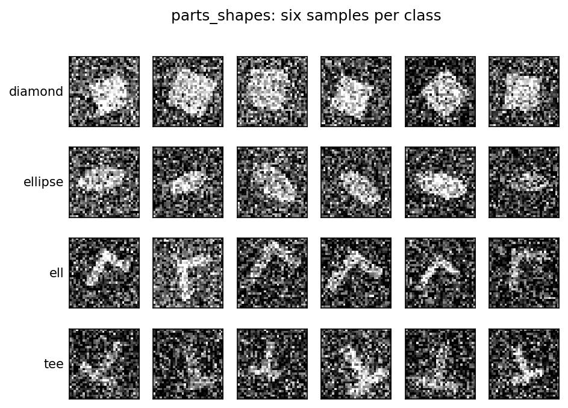
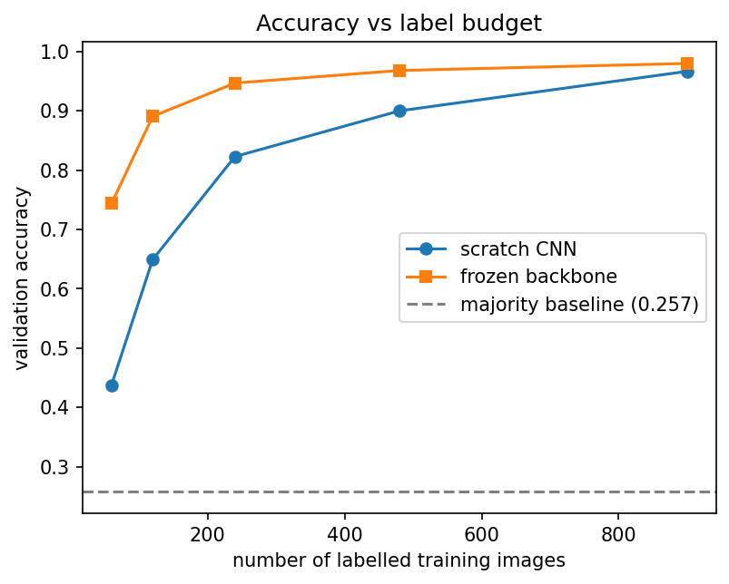
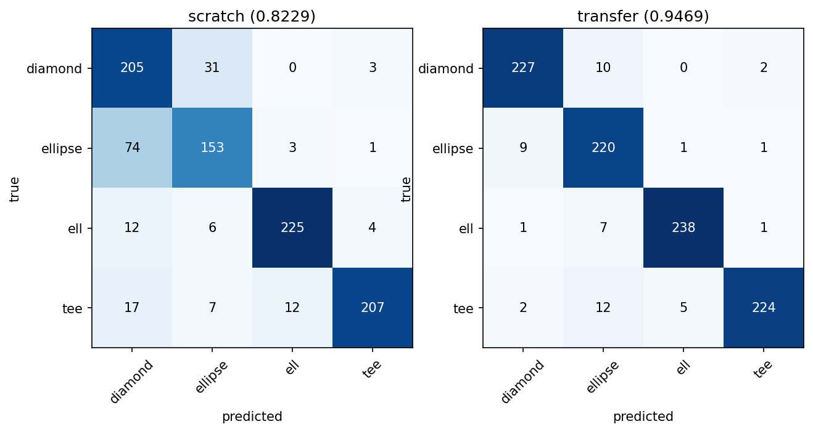

# Lab 5 리포트 — 20212788 최재원

## 1. 수행 내용

스켈레톤의 네 TODO 블록을 명세대로 구현했고, 벗어난 부분은 없습니다. `conv_output_shape`는
레이어를 만들어 더미 텐서의 모양을 읽는 대신 `floor((L+2p-k)/s)+1` 을 파이썬 정수 나눗셈으로
직접 계산하므로, 할당할 수 없는 크기의 입력에도 동작합니다.

`build_transfer_model`은 저장된 `state_dict`에서 `features.` 로 시작하는 키만 골라
`model.features`에 싣고, 6클래스용 헤드는 버린 뒤 `build_cnn`이 만든 새 헤드를 그대로
둡니다. 그다음 `freeze_backbone`으로 백본 전체의 `requires_grad`를 끄므로
`make_optimizer`에는 헤드 파라미터만 전달됩니다.

## 2. 결과

**표 1. 같은 분할·같은 시드·같은 학습 예산에서의 두 모델.** baseline 행은 나머지 두 모델이
넘어야 할 기준선이고, 파라미터 열은 비교의 두 번째 축입니다. 이 표의 요점은 정확도가 더 높은
모델이 더 적은 가중치를 학습했다는 것입니다.

| 모델 | 검증 정확도 | 학습 가능 파라미터 |
|-------|---------------------|----------------------|
| baseline (최빈 클래스) | 0.2573 | 0 |
| 밑바닥부터 학습한 CNN | 0.8229 | 7,940 |
| **동결 백본 + 새 헤드** | **0.9469** | **2,052** |

학습에 쓴 레이블은 240장뿐이고, 나머지 960장이 검증 집합입니다.

## 3. 그림

**그림 1. 클래스별 샘플 이미지 (행마다 한 클래스).** 같은 클래스 안에서도 크기, 회전, 위치,
잡음의 양이 제각각입니다. `ell`과 `tee`는 가는 선으로 그려진 반면 `diamond`와 `ellipse`는 둘 다
속이 찬 덩어리여서 윤곽이 각진지 둥근지로만 갈리므로, 이 두 클래스가 서로 헷갈릴 것으로
보입니다.

**그림 2. 레이블 수에 따른 검증 정확도.** 레이블 60장에서 두 모델의 격차가 0.3062로 가장 크고,
레이블이 늘수록 0.2416, 0.1240, 0.0681, 0.0133으로 단조 감소합니다. 900장 부근에서 두 곡선이
거의 만나므로, 레이블이 더 늘어나면 교차하거나 붙어서 갈 것으로 보입니다.

**그림 3. 밑바닥 학습과 전이의 혼동행렬.** 밑바닥 모델의 오분류 170건 중 105건(61.8%)이
`diamond`와 `ellipse` 사이에서 나오고, 특히 `ellipse`를 `diamond`로 본 것이 74건입니다. 그림 1에서
두 클래스가 모두 속이 찬 덩어리였던 것이 그대로 나타난 결과입니다.

## 4. 해석

**전이 모델은 가중치의 4분의 1만 갱신하면서 더 높은 정확도를 냅니다.** 표 1에서 전이 모델이
학습하는 파라미터는 2,052개로, 밑바닥 모델 7,940개의 25.8%인데, 정확도는 0.8229 대
0.9469로 12.4%p 더 높다는걸 확인 했습니다. 백본이 다른 6개 도형 9,000장으로 이미 학습된 상태이고, 그 과정에서
배운 것이 모서리, 곡선, 채워진 영역처럼 일반적인 특징이기 때문이라 생각됩니다. 
밑바닥 모델은 240장만으로 그 특징을 처음부터 만들어내야 하는데, 그림 2에서 확인되듯이
그 정도로는 부족해 보입니다. 전이 모델은 레이블 120장만으로 0.8907에 도달해, 밑바닥 모델이 240장을
쓰고도 얻지 못한 정확도를 절반의 레이블로 넘어섰습니다.

**baseline 0.2573은 클래스가 균형 잡혀 있다는 뜻입니다.** 1,200장이 네 클래스에 298, 289, 309,
304장으로 나뉘어 있으므로 최빈 클래스만 찍으면 4분의 1 언저리가 나옵니다. 정확도 0.25가
"아무것도 모르는 상태"라는 뜻이고, 여기서는 정확도를 그대로 읽어도 과대평가될 위험이 적다고 생각됩니다.

**전이 모델에서 기울기는 헤드에서 멈춥니다.** `freeze_backbone`이 `features`의 모든 파라미터에
`requires_grad = False`를 걸기 때문에 역전파가 백본 가중치에 대한 기울기를 계산하지 않고,
`make_optimizer`가 `requires_grad`가 켜진 파라미터만 모으므로 옵티마이저는 백본을 아예 보지
못합니다. 백본을 푼다면 7,940개가 전부 움직이게 되는데, 240장이라는 레이블 수에 비해 자유도가
커져 과적합 위험이 생길 것으로 생각됩니다. 더 큰 문제는 학습 초기에 헤드가 아직 무작위라서 큰 기울기가
흘러들어와, 9,000장으로 얻은 백본의 특징을 몇 번의 갱신만으로 망가뜨릴 수 있다는 점입니다.

**어려운 클래스는 `diamond`와 `ellipse`이고, 그림 1이 그 이유를 설명합니다.** 그림 3에서 밑바닥
모델의 `ellipse` 재현율은 0.662로 네 클래스 중 가장 낮고, `ell`의 0.911과는 차이가 많이 납니다. 그림
1을 보면 `ell`과 `tee`는 가는 선으로 그려져 전체 윤곽만 봐도 구분되는 반면, `diamond`와 `ellipse`는
둘 다 비슷한 크기의 채워진 덩어리라 경계가 각진지 둥근지라는 국소적인 차이에 달려 있어 보입니다.
32×32 해상도에 잡음까지 섞이면 그 차이는 몇 픽셀 수준입니다. 전이 모델은 같은 쌍의 오분류를
105건에서 19건으로 줄여 `ellipse` 재현율을 0.952까지 끌어올리는데, 미리 학습된 백본이 그 국소적인
윤곽 차이를 이미 표현할 줄 안다는 뜻입니다.

## 5. 한계

전이의 이점은 레이블이 적을 때만 큰 것 같습니다. 그림 2에서 격차는 60장일 때 0.3062였다가 900장에서
0.0133까지 줄어들어 거의 사라집니다. 즉 "동결 백본이 밑바닥 학습보다 낫다"는 이 실험의 결론은
레이블 240장이라는 조건에 붙어 있는 것이지, 어떤 레이블 수에서도 성립하는 주장은 아니라 생각됩니다.
레이블을 충분히 모을 수 있다면 밑바닥 학습이 따라잡고, 백본이 원래 과제에 맞춰져 있다는 제약이
오히려 불리해질 수 도 있을 것 같습니다. 또한 모든 수치가 시드 42의 단일 분할에서 나왔고 백본도 하나뿐이므로,
원래 과제가 이 과제와 덜 비슷했다면 격차가 어떻게 달라지는지는 이 실험으로만은 알 수 없습니다.

## AI 및 외부 코드 사용

| 도구 / 출처 | 사용한 부분 | 내가 수정하고 검증한 내용 |
|-------------|-------------|---------------------------|
| Claude (Anthropic) | `src/lab05.py`의 네 TODO 블록 코드 초안 작성, PyTorch API 확인(`nn.Sequential`, `load_state_dict`, `requires_grad`, `torch.flatten`), `lab05_concepts.pdf` 내용 설명 | 초안을 읽고 각 줄의 의미를 확인한 뒤 내 코딩 스타일에 맞게 정리했다. 공개 테스트 6개와 두 번 실행 시 동일한 `results.json`으로 동작을 검증했다. |
| Claude (Anthropic) | 리포트 초안 작성(섹션 구성, 표 1 수치 정리, 레이블 예산별 격차·클래스별 재현율·혼동 쌍 비중 계산) | 초안을 읽고 이해한 뒤 내 문장으로 다시 썼다. 인용된 수치는 `results.json` 및 `src/lab05.py`의 출력과 직접 대조해 확인했다. |
