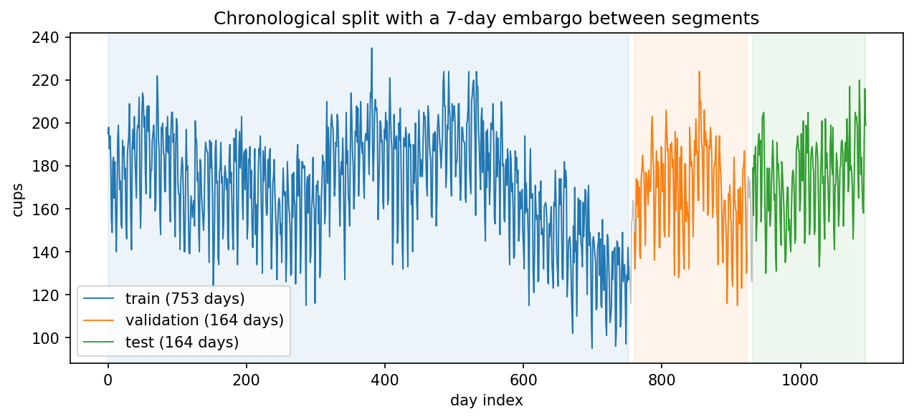
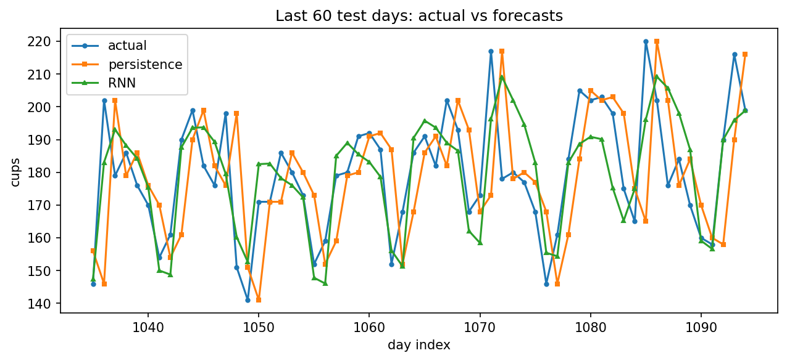
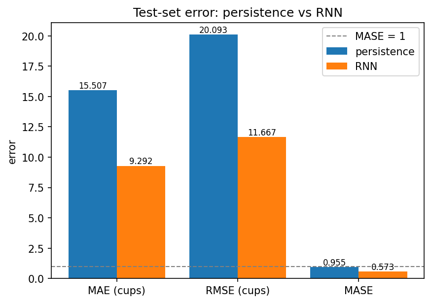

# Lab 6 리포트 — 20212788 최재원

## 1. 수행 내용

스켈레톤의 네 TODO 블록을 명세대로 구현했고, 벗어난 부분은 없습니다. 어떤 단계에서도 섞지
않았습니다. `temporal_split`은 위치를 시간 순서대로 잘라 train, val, test를 배치하고 그
사이마다 7일을 버립니다.

표준화 상수는 훈련 구간에서만 계산했고, 세 구간을 **각각 따로** 윈도우로 잘랐습니다. 한
윈도우가 구간 경계를 넘어가면 그 입력에는 엠바고로 버린 날이나 다른 구간의 날이 섞여
들어가기 때문입니다.

## 2. 결과

**표 1. 같은 테스트 윈도우·같은 분할·같은 시드에서의 두 예측기.** persistence 행은 RNN이
넘어야 할 기준선이고, 그 MASE가 0.9554라는 것은 "어제 값 반복"이 이미 이 시계열의 하루
변동폭만큼은 맞힌다는 뜻입니다.

| 예측기 | MAE (cups) | RMSE (cups) | MASE |
|------------|------------|-------------|------|
| persistence (어제 값) | 15.5067 | 20.0934 | 0.9554 |
| **GRU (윈도우 14)** | **9.2921** | **11.6667** | **0.5725** |

분할 크기(윈도우 수): train **739** / validation **150** / test **150**.
훈련 구간에서만 계산한 표준화 상수: mean **170.4754**, std **25.5496**.
naive_scale(훈련 구간의 평균 일간 변화량) = **16.2314** cups.

## 3. 그림

**그림 1. 전체 시계열과 시간 순서 분할.** 왼쪽부터 train, validation, test가 시간 순서대로
놓여 있어 어떤 훈련 시점도 검증·테스트 시점보다 뒤에 오지 않습니다. 세 구간 사이의 회색
구간 두 곳이 엠바고로, 경계 근처의 윈도우가 양쪽 구간을 함께 보는 일을 막기 위해 7일씩
버린 자리입니다.

**그림 2. 마지막 60일의 실제값과 두 예측.** persistence(주황)는 실제값(파랑)을 하루
오른쪽으로 민 모양이어서, 값이 크게 꺾이는 날마다 한 칸씩 늦게 반응합니다. 가장 크게
빗나가는 지점들은 주말로 내려가거나 주초로 올라오는 전환일에 몰려 있습니다.

**그림 3. 두 예측기의 테스트 오차.** MAE와 RMSE는 cups 단위라 크기만 보여주지만, MASE는
기준선 1과 비교할 수 있습니다. persistence는 0.9554로 1 바로 아래에 붙어 있고 RNN은
0.5725로 그 절반 수준입니다.

## 4. 해석

**persistence가 이미 잘 맞는 이유는 이 시계열이 하루 사이에 크게 변하지 않기 때문입니다.**
훈련 구간의 평균 일간 변화량은 16.2 cups이고, 이 값은 평균 판매량 170.5에 비해 매우 낮습니다. 수준이
천천히 흐르고 연간 변동도 느리므로, 오늘 값과 어제 값은 매우 비슷합니다. 
표 1의 MASE 0.9554이 이를 의미합니다. persistence의 오차가 이 시계열이 하루에 움직이는 폭과 거의
같다는 뜻입니다.

**persistence가 틀리는 날은 요일 전환일입니다.** 요일별 평균은 월~목이 180 언저리, 금요일
172.3, 토요일 148.0, 일요일 146.4입니다. 테스트 구간에서 persistence의 요일별 MAE를 보면
월요일 34.2, 토요일 23.3으로 다른 요일(8~12)보다 두세 배 큽니다. 오차 상위 10일 중 7일이
월요일, 2일이 토요일입니다. 금요일에서 토요일로 24 cups 떨어지고 일요일에서 월요일로 35
cups 올라오는 지점을 전 날 값으로는 따라갈 수 없기 때문입니다. 그림 2에서 주황 선이 한 칸
늦게 꺾이는 것이 이것을 나타냅니다. RNN은 14일짜리 윈도우를 받으므로 그 안에 같은 요일이 두 번
들어 있고, 요일 주기를 읽어 전환을 미리 반영합니다. 그래서 월요일 MAE를 34.2에서 8.7로
(74.5%), 토요일을 23.3에서 8.7로(62.9%) 줄입니다. 상관계수로 보면 persistence의 예측은
하루 전 실제값과 상관이 1.0000인 반면 당일 실제값과는 0.4686밖에 안되고, RNN은 당일과 0.8096입니다.

**MASE를 인용해야 하는 이유는 MAE 값이 좋은지 나쁜지를 혼자서는 알 수 없기 때문입니다.**
9.3 cups는 하루 평균 170잔을 파는 가게에서는 작은 값이지만 20잔을 파는 가게에서는 치명적인 값입니다.
MASE는 그 오차를 **이 시계열이 하루에 움직이는 폭**으로 나누므로 단위가 사라지고 1이 자연스러운
기준이 됩니다. 1보다 작으면 "하루 변동폭보다 적게 틀린다"는 뜻이고, 표 1의 0.5725는 그
절반 수준이라는 뜻입니다. 다른 가게, 다른 기간과 비교할 수 있는 숫자도 MASE뿐입니다.

**날짜를 섞어 나눴다면 세 숫자가 모두 좋아졌을 것이고, 전부 거짓이었을 것입니다.** 무작위
분할에서는 훈련 집합에 테스트 날짜의 바로 앞뒤 날이 들어옵니다. 모델은 테스트 시점 주변의
수준과 요일 패턴을 이미 본 상태로 예측하게 되므로 오차가 낮아지지만, 실제 운영에서는 내일을
예측할 때 내일 이후의 데이터를 쓸 수 없습니다. 그래서 그 숫자는 재현되지 않습니다. 이 랩이
섞기를 금지하고 엠바고까지 두는 이유가 이 때문이라고 생각됩니다.

## 5. 한계

모든 수치가 시드 42의 단일 분할, 단일 테스트 구간에서 나왔습니다. 테스트는 시계열의 마지막
150일뿐이므로, 그 기간에 수준 변화나 특별한 사건이 있었다면 결론이 달라졌을 것입니다. 요일별로
보면 그 불안정성이 이미 보입니다. 수요일에는 RNN의 MAE가 10.6으로 persistence의 8.6보다
오히려 나쁩니다. 즉 RNN의 우위는 전체 평균에서는 뚜렷하지만 모든 요일에서 성립하지는
않습니다. 또한 horizon이 1이어서 "하루 뒤"만 예측하므로, 일주일 뒤를 예측해야 한다면
persistence는 급격히 나빠지는 반면 RNN이 어느정도 인지는 이 실험으로 알 수 없습니다.
결론을 일반화하려면 테스트 구간을 앞뒤로 옮겨가며 반복하는 평가가 필요하다고 생각됩니다.

## AI 및 외부 코드 사용

| 도구 / 출처 | 사용한 부분 | 내가 수정하고 검증한 내용 |
|-------------|-------------|---------------------------|
| Claude (Anthropic) | `src/lab06.py`의 네 TODO 블록 코드 초안 작성, PyTorch·numpy API 확인(`nn.GRU`, `batch_first`, 슬라이싱), `lab06_concepts.pdf` 내용 설명 | 초안을 읽고 각 줄의 의미를 확인한 뒤 내 코딩 스타일에 맞게 정리했다. 공개 테스트 6개와 `results.json` 출력으로 동작을 검증했다. |
| Claude (Anthropic) | 리포트 초안 작성(섹션 구성, 표 1 수치 정리, 요일별 MAE·오차 상위일의 요일 분포·예측 상관계수 계산) | 초안을 읽고 이해한 뒤 내 문장으로 다시 썼다. 인용된 수치는 `results.json` 및 `src/lab06.py`의 출력과 직접 대조해 확인했다. |
