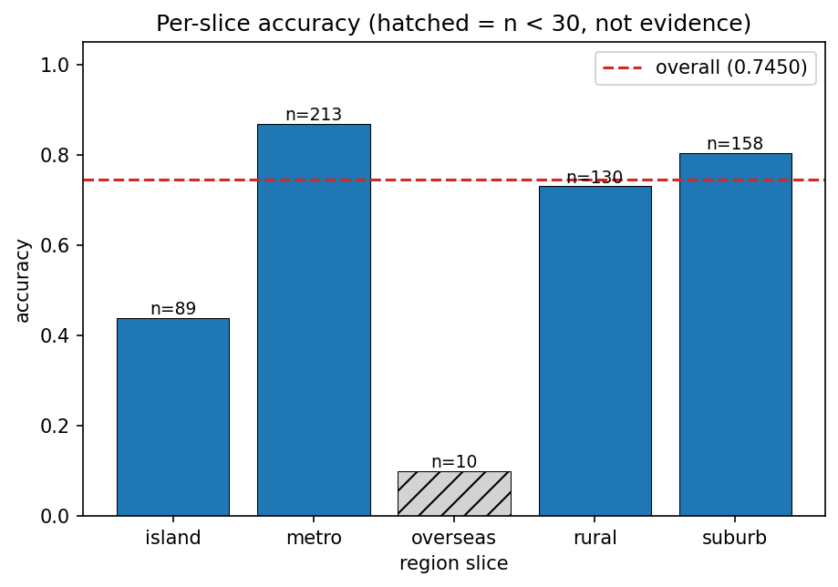
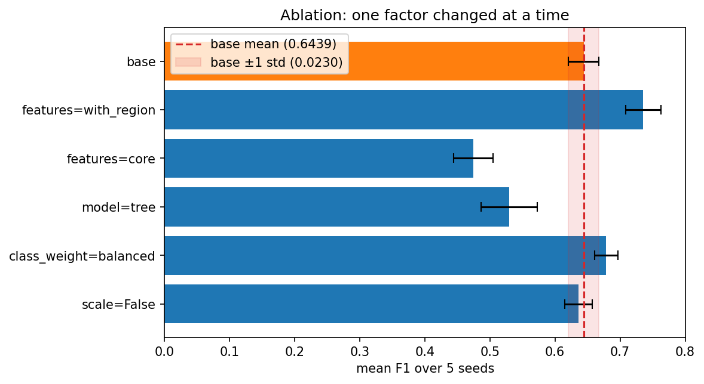
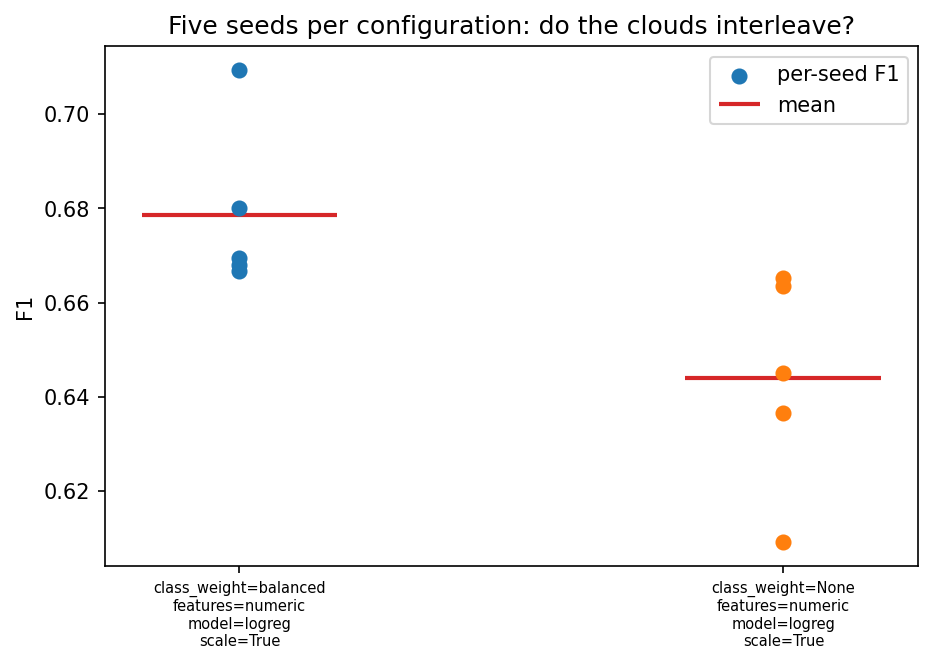

# Lab 8 리포트 — 20212788 최재원

## 1. 수행 내용

스켈레톤의 네 TODO 블록을 명세대로 구현했고, 벗어난 부분은 없습니다. `run_config`는 키
집합이 `BASE_CONFIG`와 다르면 즉시 `ValueError`를 내고, 기록에는 `dict(config)` 사본을
담아 호출자가 자기 딕셔너리를 바꿔도 기록이 따라 바뀌지 않게 했습니다.

`run_ablation`은 데이터를 한 번만 읽어 모든 실행에 넘기고, 각 변형을 `base_config`의 복사본에
키 하나만 바꿔 만듭니다. `summarize`의 `overlaps_best`는 표에 적힌 반올림된 mean과 std로
계산하며, 시드가 하나뿐이라 std가 nan인 행은 0.0으로 간주합니다.

## 2. 결과

**표 1. 한 번에 한 요인씩만 바꾼 결과, 각 5시드.** 먼저 읽을 열은 "base 대비 차이"가 아니라
**"base 표준편차의 몇 배인가"** 입니다. std 열이 있는 이유가 그것으로, 시드만 바꿔도 F1이
0.023만큼 움직이므로 그보다 작은 차이는 요인의 효과라고 말할 수 없습니다.

| 변형 | 평균 F1 | F1 std | base 대비 차이 | base 분산보다 큰가? |
|---------|---------|--------|----------------------|------------------------------|
| base | 0.6439 | 0.0230 | 0.0000 | — |
| **features=with_region** | **0.7355** | 0.0270 | **+0.0916** | 예, **3.98배** |
| features=core | 0.4741 | 0.0302 | −0.1698 | 예, 7.38배 (악화) |
| model=tree | 0.5292 | 0.0431 | −0.1147 | 예, 4.99배 (악화) |
| class_weight=balanced | 0.6787 | 0.0180 | +0.0348 | 애매, 1.51배 |
| **scale=False** | 0.6358 | 0.0210 | −0.0081 | **아니오, 0.35배** |

**표 2. base 설정을 지역별로 쪼갠 결과 (시드 42).** `n` 열을 먼저 보아야 정확도 열을 읽을 수
있습니다. 표본이 10개인 슬라이스의 정확도는 한두 건만 달라져도 크게 흔들리므로 수치로
취급할 수 없습니다.

| 지역 | n | Accuracy | Precision | Recall | F1 |
|--------|---|----------|-----------|--------|----|
| **island** | 89 | **0.4382** | 0.8485 | 0.3836 | 0.5283 |
| metro | 213 | 0.8685 | 0.7222 | 0.3611 | 0.4815 |
| *overseas* | *10* | *0.1000* | *0.1000* | *1.0000* | *0.1818* |
| rural | 130 | 0.7308 | 0.7529 | 0.8205 | 0.7853 |
| suburb | 158 | 0.8038 | 0.7333 | 0.6346 | 0.6804 |
| **overall** | **600** | **0.7450** | 0.7277 | 0.5792 | 0.6450 |

## 3. 그림

**그림 1. 지역별 정확도와 전체 정확도.** 전체선(0.7450)보다 가장 크게 아래에 있는 것은
`island`로 0.4382, 격차가 0.3068입니다. `overseas`는 더 낮지만 n이 10뿐이라 빗금으로
표시했고 결론의 근거로 쓰지 않습니다.

**그림 2. 한 요인씩 바꾼 평균 F1과 ±1 std (5시드).** `features=with_region`,
`features=core`, `model=tree`의 오차막대는 base 띠에서 완전히 벗어나 있고,
`class_weight=balanced`는 걸치며, `scale=False`는 띠 안에 들어 있습니다.

**그림 3. base와 challenger의 시드 5개씩.** 두 점 구름은 0.0015 차이로 간신히 떨어져 있을
뿐이며(base 최대 0.6652, challenger 최소 0.6667), 겹치지 않았다는 사실만으로 우열을 주장하기에는
너무 가깝습니다.

## 4. 해석

**성능을 좌우한 것은 모델이 아니라 특징입니다.** 표 1에서 변화가 가장 큰 변형은
`features=core`로, 특징을 7개에서 3개로 줄이자 F1이 0.1698 떨어졌습니다. base의 시드 간
표준편차가 0.0230이므로 이는 표준편차의 7.38배에 해당합니다. 반대 방향도 같은 이야기를
합니다. 지역 정보를 더한 `features=with_region`은 F1을 0.0916 올렸고, 이는 표준편차의
3.98배입니다. 두 변형 모두 특징을 바꾼 것인 반면, 모델을 트리로 교체한 `model=tree`는
오히려 F1을 0.1147 떨어뜨렸습니다. 이 문제에서는 어떤 모델을 쓰는지보다 어떤 특징을
입력으로 주는지가 결과를 결정합니다.

**`scale=False`는 아무 효과도 입증하지 못했습니다.** 표 1에서 이 변형의 차이는 −0.0081로
base 표준편차의 0.35배에 그치고, 그림 2에서도 오차막대가 base 띠 안에 완전히 들어가
있습니다. 만약 시드를 하나만 돌렸다면 그 한 번의 결과는 base보다 높을 수도 낮을 수도
있었고, 어느 쪽이 나왔든 "스케일링을 끄니 성능이 달라졌다"고 보고했을 것입니다. 시드를
다섯 개 돌리고 표준편차를 함께 기록했기 때문에 "차이가 없다"는 결론을 낼 수 있었습니다.

**가장 나쁜 지역은 `island`이고, 원인은 지연을 놓치는 데 있습니다.** 표 2에서 n이 30 이상인
지역 중 정확도가 가장 낮은 곳은 `island`의 0.4382로, 전체 0.7450보다 0.3068 낮습니다.
그림 1에서 전체선 아래로 가장 멀리 떨어진 막대가 이것입니다. 원인은 재현율에서 드러납니다.
`island`는 실제로 82%가 지연인데 모델은 37%만 지연으로 예측해, 지연 73건 중 45건을
놓쳤습니다. 모델이 전체 평균 지연율 40%를 기준으로 학습했기 때문이며, 지연이 기본값인
지역에서는 그 기준이 너무 낮습니다. 표 1의 `class_weight=balanced`가 바로 이 과소예측을
교정하는 요인으로 F1을 0.0348 올리지만, 표준편차의 1.51배라 아직 효과라고 주장할 수는
없습니다.

**`overseas` 행에서는 어떤 결론도 낼 수 없습니다.** n이 10뿐이라 한 건만 달라져도 정확도가
0.1씩 움직입니다. 실제로 이 지역에서 모델은 10건 전부를 지연으로 예측했고 실제 지연은
1건이어서 정확도가 0.1000이 되었습니다. 재현율은 1.0000으로 완벽해 보이지만 이는 "전부
양성이라고 찍었다"는 말과 같습니다. `error_analysis`가 `min_count=30`에 못 미치는 슬라이스를
worst_slice 후보에서 제외하는 이유가 이것이고, 그림 1에서도 이 막대만 빗금으로 표시했습니다.

**`metro`에서는 정확도와 재현율이 정반대를 말하지만 둘 다 사실입니다.** 정확도는 0.8685로 큰
지역 중 가장 높은 반면 재현율은 0.3611로 가장 낮습니다. 이 지역의 실제 지연율이 16.9%뿐이라
대부분이 "지연 아님"이기 때문입니다. 모델은 거의 "지연 아님"으로만 답하는데(예측 지연율
8.5%) 그러면 틀릴 일이 적으니 정확도는 높게 나옵니다. 그러나 실제 지연 건은 3분의 1만
찾아냅니다. 정확도만 보고했다면 `metro`를 가장 잘 되는 지역으로 기록했겠지만, 지연을 놓치지
않는 것이 목적이라면 정반대의 결론입니다.

## 5. 한계

모든 비교가 시드 5개에 기대고 있습니다. 표 1에서 `class_weight=balanced`는 base보다 평균이
0.0348 높지만 그 차이는 base 표준편차의 1.51배이고, `summarize`의 `overlaps_best`도 True를
돌려줍니다. 그림 3에서 두 점 구름이 0.0015 차이로 간신히 떨어져 있는 것도 같은 이야기입니다.
시드를 20개, 50개로 늘리면 표준오차가 줄어 이 차이가 실제 개선으로 확정될 수도 있고, 반대로
평균이 겹치며 사라질 수도 있습니다. 즉 "balanced가 낫다"는 지금 데이터로는 참도 거짓도 아닌
미결 상태이며, 결론을 내리려면 시드를 늘리는 것이 모델을 바꾸는 것보다 먼저입니다.

## AI 및 외부 코드 사용

| 도구 / 출처 | 사용한 부분 | 내가 수정하고 검증한 내용 |
|-------------|-------------|---------------------------|
| Claude (Anthropic) | `src/lab08.py`의 네 TODO 블록 코드 초안 작성, pandas·numpy API 확인(`sort_values`, `reset_index`, `std(ddof=1)`, `np.unique`), `lab08_concepts.pdf` 내용 설명 | 초안을 읽고 각 줄의 의미를 확인한 뒤 내 코딩 스타일에 맞게 정리했다. 공개 테스트 6개와 `results.json` 출력으로 동작을 검증했다. |
| Claude (Anthropic) | 리포트 초안 작성(섹션 구성, 표 1·2 수치 정리, base 표준편차 대비 배수·슬라이스별 양성률·island 혼동행렬 계산) | 초안을 읽고 이해한 뒤 내 문장으로 다시 썼다. 인용된 수치는 `results.json` 및 `src/lab08.py`의 출력과 직접 대조해 확인했다. |
