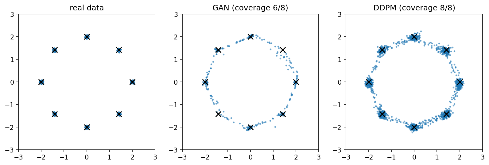
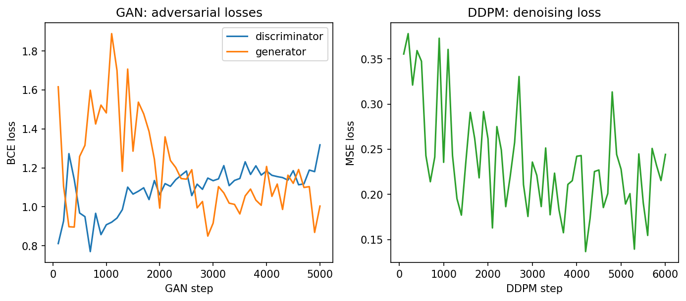
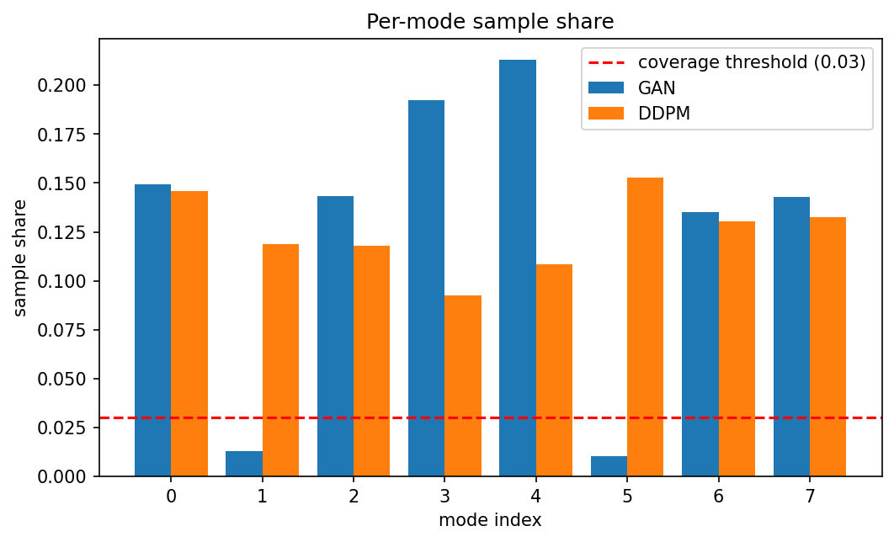

# Lab 9 리포트 — 20212788 최재원

## 1. 수행 내용

스켈레톤의 네 TODO 블록을 명세대로 구현했고, 벗어난 부분은 없습니다. `gan_step`에서는
판별자 단계의 가짜 샘플에 `.detach()`를 걸어 그 역전파가 생성자로 흘러들지 않게 했고,
생성자는 비포화(non-saturating) 손실을 써서 판별자가 이길 때도 기울기가 살아 있게 했습니다.

난수는 전부 주입받은 `torch.Generator`에서만 꺼냈습니다. `ddpm_sample`은 초기 1회와 t가 0보다
큰 동안의 (T−1)회, 정확히 그 순서로만 난수를 뽑으며 t = 0에서는 잡음을 더하지 않습니다.
`mode_centers`는 `run_experiment`의 `mode_stats` 호출에서만 읽습니다.

## 2. 결과

**표 1. 같은 데이터·같은 시드·같은 평가 기준에서의 두 생성 모델.** 해석이 기대고 있는 것은
커버리지와 고품질 비율이 **서로 반대 방향으로** 갈린다는 점입니다.

| 지표 | GAN | DDPM |
|--------|-----|------|
| 모드 커버리지 (8개 중) | **6** | **8** |
| 고품질 샘플 비율 | **0.9420** | 0.8585 |
| 2,000개 샘플링 벽시계 (초) | **0.0005** | 0.1329 |
| 최종 학습 손실 | D: 1.3181 / G: 1.0039 | 0.2443 |

학습 예산은 GAN 5,000스텝, DDPM 6,000스텝으로 고정되어 있고 두 모델 모두 2,000개를
생성했습니다. 벽시계를 제외한 모든 값은 두 번 실행해도 동일했습니다.

## 3. 그림

**그림 1. 실데이터, GAN 샘플, DDPM 샘플.** GAN 패널에서는 오른쪽 위와 왼쪽 아래의 X 주변에
점이 거의 없어 두 모드를 생성하지 못했음이 바로 보이고, 남은 여섯 모드에는 점이 좁게
뭉쳐 있습니다. DDPM 패널은 여덟 X 모두에 구름이 있지만 모드 사이 고리 위에도 점이 흩어져
있어 전체적으로 더 퍼져 있습니다.

**그림 2. 학습 손실 곡선.** GAN의 두 손실은 서로 밀고 당기며 오르내리고, 판별자 손실은
0.8115에서 1.3181로 오히려 올라갑니다. DDPM 손실은 0.3555에서 0.2443으로 거의 단조
감소합니다. 어느 곡선도 모드를 몇 개 덮었는지는 말해 주지 않습니다.

**그림 3. 모드별 샘플 점유율.** 빨간 임계선(0.03) 아래로 내려간 막대는 GAN의 모드 1(0.0130)과
모드 5(0.0105) 둘뿐이고, DDPM은 여덟 막대가 모두 선 위에 있습니다(최소 0.0925).

## 4. 해석

**두 모델은 서로 반대되는 것을 잘합니다.** 
표 1에서 GAN은 커버리지 6, 고품질 비율 0.9420이고
DDPM은 커버리지 8, 고품질 비율 0.8585입니다. 두 지표가 보상하는 것이 다르기 때문입니다.
고품질 비율은 **생성한 점이 어떤 모드든 가까운가**만 보므로, 몇 개 모드만 정확해도 높게 나옵니다. 
커버리지는 **모든 모드가 제 몫만큼 나오는가**를 보므로 한 모드라도 버리면 떨어집니다. 
그림 1이 그 차이를 그대로 보여준다고 보입니다. GAN의 점들은 남은 여섯 모드에 좁게 뭉쳐
있고, DDPM의 점들은 여덟 모드에 퍼져 있되 모드 사이 고리 위에도 흩어져 있습니다. 점유율로
보면 GAN은 최대 0.2130과 최소 0.0105로 20.3배 차이가 나는 반면 DDPM은 0.1530과 0.0925로
1.7배에 그칩니다.

**손실 곡선만으로는 커버리지를 예측할 수 없습니다.** 그림 2에서 GAN의 판별자 손실은 오히려
올라가고 생성자 손실은 내려가는데, 이는 두 네트워크가 경쟁 중이라는 뜻일 뿐 어느 쪽이
"옳은지"를 말하지 않는다고 생각합니다. GAN의 손실은 상대의 현재 실력에 대한 상대적인 값이어서, 모드를
두 개 버린 생성자라도 남은 여섯 개를 잘 만들면 판별자를 속일 수 있고 손실은 낮게 유지됩니다.
DDPM 손실은 절대적인 양(섞어 넣은 잡음과 예측한 잡음의 MSE)이라 해석이 쉽지만, 그 값 역시
어떤 모드가 몇 번 나오는지는 담고 있지 않습니다. 모드 붕괴는 손실이 아니라 그림 3 같은
샘플 분포를 봐야 드러난다고 생각됩니다.

**샘플 하나당 네트워크 통과 횟수가 266배의 시간 차이를 만듭니다.** GAN은 잠재 벡터를 생성자에
한 번 통과시키면 끝이므로 네트워크 호출이 샘플당 1회입니다. DDPM의 `ddpm_sample`은
t = 99부터 0까지 역방향 루프를 돌며 매 단계 `model(x, tt)`를 부르므로 **T_DIFF = 100회**입니다.
표 1에서 2,000개를 뽑는 데 GAN이 0.0005초, DDPM이 0.1329초로 266배 차이가 난 것이 이것 떄문이라고 생각됩니다. 
이것은 구현을 다듬어 줄일 수 있는 상수가 아니라 역방향 체인의 길이에서
직접 나오는 값입니다.

**`MODE_SHARE_MIN`을 두 배로 올려도 결과는 바뀌지 않습니다.** 임계값이 0.03에서 0.06이 되면
GAN에서 미달인 모드는 여전히 1번(0.0130)과 5번(0.0105)뿐이고, 남은 여섯 모드의 최소값은
0.1350으로 새 임계값의 두 배가 넘습니다. DDPM도 최소가 0.0925라 전부 통과합니다. 즉 그림
3에서 두 모델의 막대는 임계선 근처가 아니라 훨씬 위나 훨씬 아래에 있고, 커버리지 6 대 8이라는
결론은 임계값을 어디에 두느냐에 큰 영향을 받지 않는다고 예상됩니다.

## 5. 한계

모든 수치가 시드 42의 한 번의 학습에서 나왔고, 예산도 GAN 5,000스텝·DDPM 6,000스텝으로
한 번씩만 시도했습니다. 모드 붕괴는 초기화와 학습 동역학에 민감한 현상이라, 다른 시드에서는
GAN이 버리는 모드가 1번과 5번이 아닐 수도 있고 개수도 달라질 수 있습니다. 따라서 이
실험이 보여주는 것은 "이 GAN 설정이 이 시드에서 모드 둘을 버렸다"이며, "GAN이 항상 모드를
버린다"라고 하긴 어렵습니다. 반대로 샘플링 비용의 266배 차이는 시드와 무관합니다. 역방향 체인이
T_DIFF번 돈다는 구조에서 나오는 값이기 때문입니다. 경향을 주장하려면 여러 시드로
반복해 커버리지의 평균과 편차를 함께 보고해야 할 것 같습니다.

## AI 및 외부 코드 사용

| 도구 / 출처 | 사용한 부분 | 내가 수정하고 검증한 내용 |
|-------------|-------------|---------------------------|
| Claude (Anthropic) | `src/lab09.py`의 네 TODO 블록 코드 초안 작성, PyTorch API 확인(`binary_cross_entropy_with_logits`, `cumprod`, `torch.Generator`), `lab09_concepts.pdf` 내용 설명 | 초안을 읽고 각 줄의 의미를 확인한 뒤 내 코딩 스타일에 맞게 정리했다. 공개 테스트 6개와 두 번 실행 시 벽시계를 제외한 모든 값이 동일함을 확인해 검증했다. |
| Claude (Anthropic) | 리포트 초안 작성(섹션 구성, 표 1 수치 정리, 모드별 점유율 불균형·임계값 2배 시나리오·곡선 변동성 계산) | 초안을 읽고 이해한 뒤 내 문장으로 다시 썼다. 인용된 수치는 `results.json` 출력과 직접 대조해 확인했다. |
